# Zjude Aden 家政服务系统

Zjude Aden 是一套面向家政、上门服务和本地生活服务场景的开源基础系统，包含：

- 微信小程序：用户端与师傅端合二为一，根据账号审核状态和用户选择自动切换。
- 后台管理系统：用于配置服务、审核师傅、管理订单、维护内容和处理运营数据。
- Java 后端服务：统一提供认证、业务、支付、文件上传、消息和管理接口。

项目适合家政保洁、维修安装、陪护、月嫂、搬家以及其他按时间预约的上门服务业务。业务名称、服务分类、价格、城市和页面内容均可通过后台配置，不需要为每个行业重新开发一套系统。

**搜索关键词：** 家政服务、上门服务、家政预约、师傅接单、接单大厅、微信小程序、双端合一、服务平台、订单管理、线下收款、OSS、Home Service、Housekeeping、Service Booking、Provider Platform、WeChat Mini Program、Spring Boot、Vue 3、uni-app。

## 目录

- [核心特点](#核心特点)
- [线上地址与界面预览](#线上地址与界面预览)
- [功能介绍](#功能介绍)
  - [小程序用户端](#小程序用户端)
  - [小程序师傅端](#小程序师傅端)
  - [后台管理系统](#后台管理系统)
- [业务流程](#业务流程)
- [系统架构](#系统架构)
- [项目结构](#项目结构)
- [环境要求](#环境要求)
- [快速开始](#快速开始)
- [关键配置](#关键配置)
- [生产部署](#生产部署)
- [开发约定](#开发约定)
- [开源说明](#开源说明)

## 核心特点

- **双端合一**：同一个微信小程序同时提供用户端和师傅端，不需要维护两个小程序项目。
- **审核后自动进入师傅端**：师傅认证通过后，下一次打开小程序可直接进入师傅工作台；用户手动切换到用户端后，会保留用户端选择。
- **服务与订单闭环**：服务展示、预约、支付、派单、接单、开工、完工、评价和退款均有对应页面或接口。
- **后台可配置**：网站信息、移动端 Logo、Banner、服务分类、服务项目、城市、上传方式、微信配置等集中管理。
- **支持线下已收款需求**：管理员可以录入已经在线下收款的需求，并将服务任务发布到师傅接单大厅，不会再次发起微信支付，也不会自动指派师傅。
- **对象存储支持**：文件上传统一经过后端存储服务，可配置本地存储、七牛云、阿里云 OSS 或腾讯云 COS。
- **可扩展基础框架**：保留用户、角色、菜单、部门、字典、通知、日志、在线用户和代码生成等通用能力。

## 线上地址与界面预览

### 线上地址

- **后台管理系统**：<https://miaoj.cc/admin/>
- **小程序业务介绍页**：<https://miaoj.cc/>
- **微信小程序**：请使用微信扫描下方二维码打开；小程序端包含用户端和师傅端，认证状态决定可用角色。

### 后台管理系统

后台管理系统用于配置服务、审核师傅、管理订单、处理退款和维护运营素材。

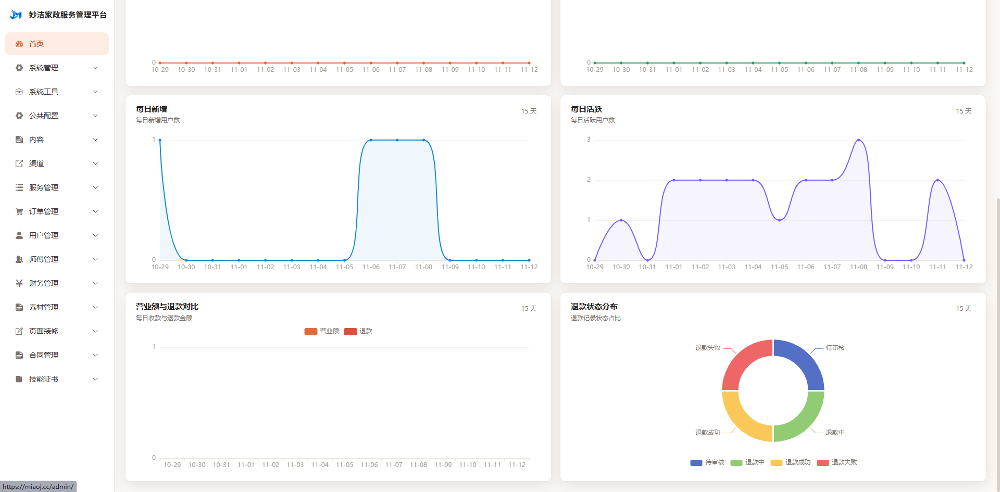

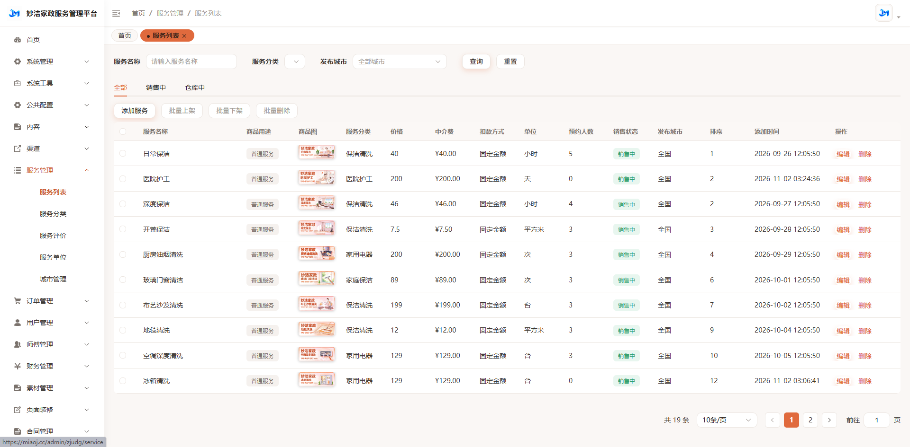

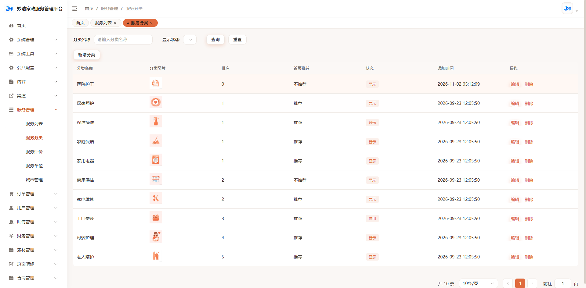

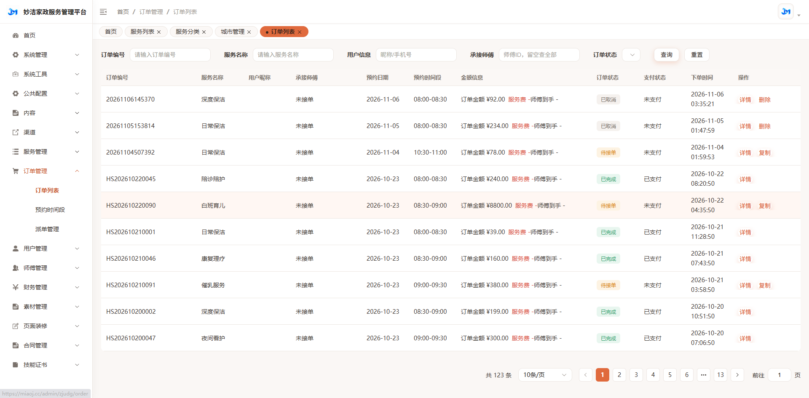

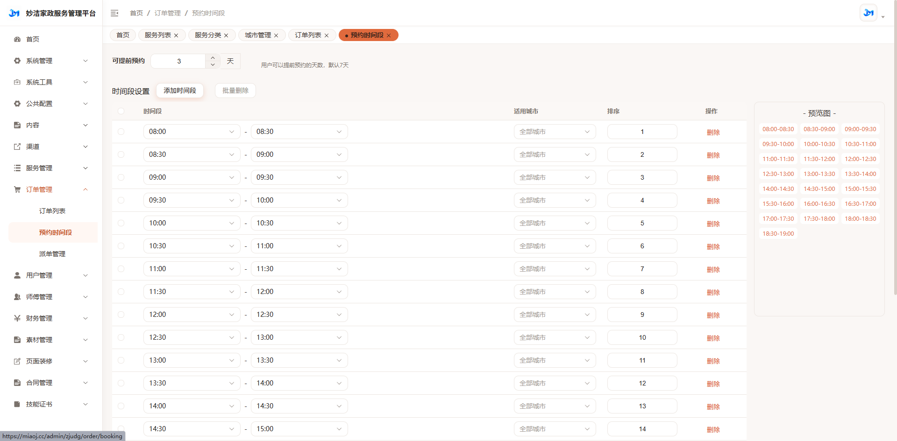

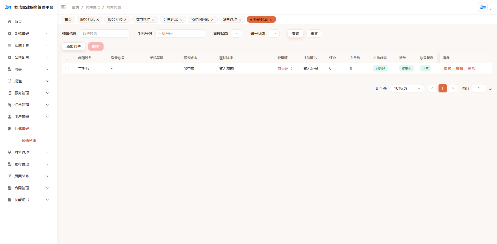

> 为避免公开展示个人联系方式，师傅列表截图中的手机号已脱敏。

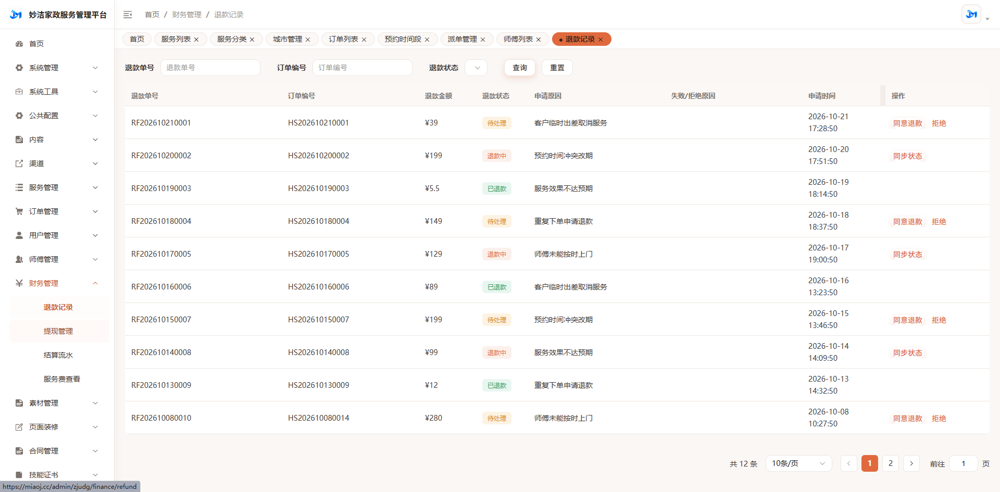

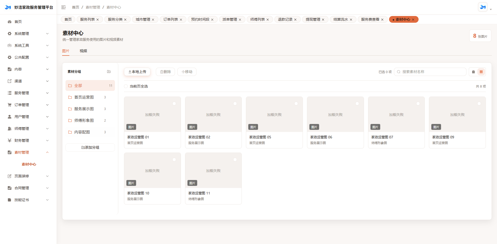

### 小程序用户端

用户端提供服务浏览、预约下单、订单查询和个人中心等功能。

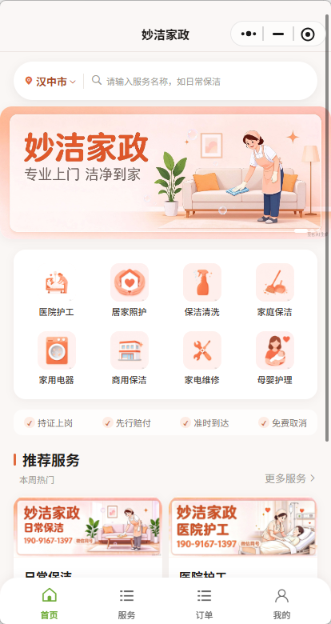

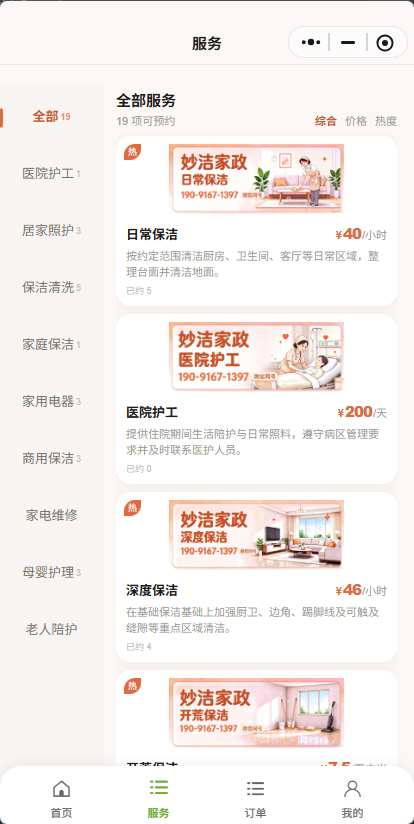


### 小程序师傅端

师傅端提供接单大厅、我的订单和个人资料等功能。师傅认证通过后可进入师傅端，用户手动切换后的端身份会被记住。

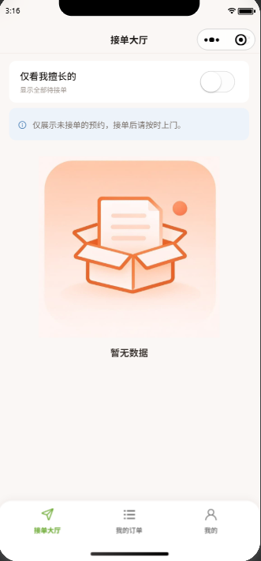

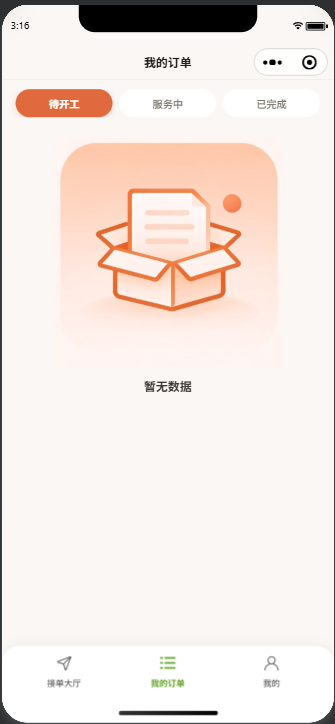

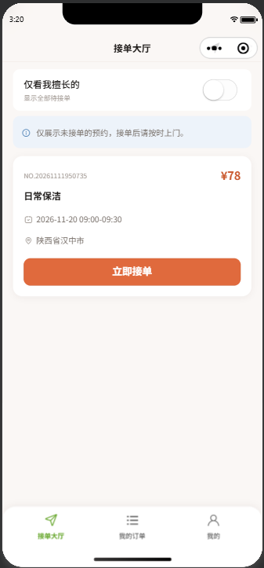

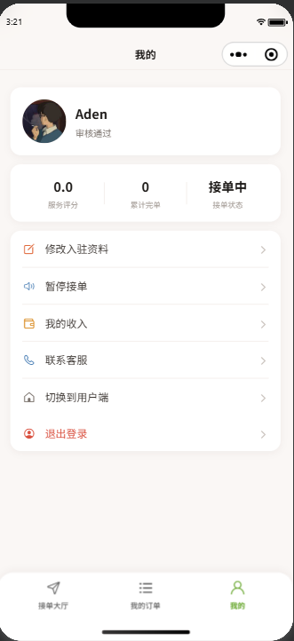

### 微信小程序二维码

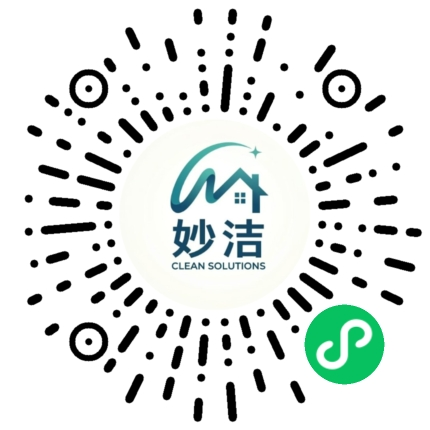

## 功能介绍

### 小程序用户端

用户无需登录即可浏览公开内容；涉及个人信息和订单的操作会引导登录。

- 首页、城市选择、服务分类和服务搜索。
- 服务详情、服务图片、价格、计价单位、预约日期和可预约时段。
- 购物车、预约下单、微信支付和支付结果同步。
- 我的订单：待支付、待接单、服务中、已完成、已取消等状态查询。
- 订单详情、取消预约、退款申请、服务评价和评价记录。
- 常用服务地址维护。
- 服务收藏和收藏数量展示。
- 技能证书产品浏览、申请和支付入口。
- 微信授权登录、手机号验证码登录和登录状态恢复。
- 个人资料、头像、昵称、后台配置的默认头像/Logo和退出登录。
- 用户协议、隐私政策、客服和关于页面。
- 已通过师傅认证的用户，可从“我的”进入师傅工作台或切换回用户端。

### 小程序师傅端

师傅端只有在认证申请通过后开放。师傅认证申请由用户端提交，后台审核通过后自动获得师傅工作台权限。

底部导航为：**接单大厅、我的订单、我的**。

- 师傅工作台：服务状态、待开工、服务中、已完成数量和接单开关。
- 接单大厅：查看符合条件的待接任务，支持接单和刷新。
- 我的订单：按待开工、服务中、已完成查看订单。
- 订单详情：查看客户、服务、预约时间、地址和备注。
- 订单状态操作：接单、拒单、确认开工、确认完工。
- 师傅资料和技能信息维护。
- 认证申请、审核状态和驳回原因查看。
- 我的收入、可提现余额、收入明细和提现记录。
- 师傅头像、昵称、评分、累计完单数和接单状态展示。
- 我的页面提供“切换到用户端”，切换结果会被记住。
- 所有二级页面提供顶部返回入口，减少重复操作。

### 后台管理系统

后台管理系统基于 Vue 3 和 Element Plus，管理员登录后按角色权限访问菜单和接口。

#### 家政业务管理

- 工作台和业务数据概览。
- 服务分类、服务单位、城市和预约时段。
- 服务项目、价格、师傅接单价、平台佣金和服务图片。
- 服务详情内容、Banner、首页装修和移动端导航。
- 用户、师傅和师傅认证申请审核。
- 订单查询、订单状态管理、退款和评价管理。
- 派单记录、师傅接单记录和接单状态维护。
- 师傅钱包、结算、收入和提现审核。
- 技能证书产品和证书申请管理。
- 素材、内容、文章/帮助分类和广告位管理。

#### 线下已收款需求

管理员可在订单管理中录入线下已经收款的客户需求，包括服务城市、服务项目、预约日期、时间段、客户信息、服务地址、时长和备注。

发布后：

1. 系统创建已线下收款的服务订单。
2. 订单进入师傅接单大厅。
3. 师傅自主接单并按正常流程开工、完工。
4. 系统不会再次发起微信支付，也不会自动指派师傅。

#### 通用系统管理

- 用户、角色、菜单、部门和岗位。
- 字典、参数配置、通知公告和操作日志。
- 登录日志、在线用户、缓存监控和服务监控。
- 微信小程序配置、短信配置、支付配置和订阅消息配置。
- 网站信息、Logo、客服信息和页面内容配置。
- 上传存储方式和对象存储参数配置。

## 业务流程

### 用户预约服务

```text
浏览首页 → 选择城市 → 选择服务 → 查看详情 → 选择日期/时段
→ 填写地址 → 提交订单 → 微信支付 → 等待接单 → 服务完成 → 评价
```

### 师傅接单服务

```text
用户提交师傅认证 → 后台审核通过 → 进入师傅工作台
→ 打开接单大厅 → 接单 → 确认开工 → 提供服务 → 确认完工 → 收入结算
```

### 线下已收款需求

```text
客户线下付款 → 管理员录入需求 → 发布到接单大厅
→ 师傅接单 → 开工 → 完工 → 进入结算流程
```

## 系统架构

```text
微信小程序（uni-app Vue 3） ─┐
                              ├─ Java Spring Boot API ─ MySQL
后台管理系统（Vue 3） ────────┘              ├─ Redis
                                             ├─ 微信能力/支付/短信
                                             └─ 文件存储（OSS/COS/七牛/本地）
```

### 技术栈

| 模块 | 技术 |
| --- | --- |
| 后端 | Java 21、Spring Boot 3.2.2、Spring Security、JWT、MyBatis、MySQL、Redis |
| 后端模块 | common、framework、system、generator、integrated、settings、admin |
| 管理端 | Vue 3、Vite、Element Plus、Pinia、Vue Router、Axios |
| 小程序 | uni-app、Vue 3、Pinia、uni-ui |
| 文件存储 | 本地存储、七牛云、阿里云 OSS、腾讯云 COS |
| 构建工具 | Maven、pnpm、HBuilder/uni CLI、微信开发者工具 |

## 项目结构

```text
home-service-system/
├─ zjude-basic-service/       # Java 后端，多模块 Maven 项目
│  ├─ zjude-aden-admin/       # 启动模块、Controller、配置
│  ├─ zjude-aden-common/      # 通用工具、注解、基础对象
│  ├─ zjude-aden-framework/   # 安全、缓存、日志、任务等框架能力
│  ├─ zjude-aden-generator/   # 代码生成器
│  ├─ zjude-aden-integrated/  # 支付、微信、对象存储等集成能力
│  ├─ zjude-aden-settings/    # 网站和小程序配置
│  └─ zjude-aden-system/      # 用户、权限和家政业务领域服务
├─ zjude-basic-ui/            # Vue 3 后台管理系统
└─ zjude-basic-mini/          # uni-app 双端合一小程序
```

小程序内部目录约定：

- `pages/`：用户端页面和师傅端页面。
- `pages/master/`：师傅端页面。
- `api/`：接口模块，页面不直接发起网络请求。
- `stores/`：Pinia 状态管理。
- `components/`：通用组件和底部导航。
- `config/index.js`：小程序唯一后端地址配置。
- `utils/request.js`：统一请求和文件上传入口。

## 环境要求

- Java 21。
- Maven 3.9 或兼容版本。
- Node.js 18+，pnpm 8+。
- MySQL 8.0+。
- Redis 6+。
- 微信开发者工具和已认证的小程序 AppID（发布微信小程序时需要）。
- 如使用微信支付、短信、地图、订阅消息或对象存储，需要对应平台的账号和合法域名配置。

## 快速开始

### 1. 准备数据库和 Redis

创建一个空的 MySQL 数据库，并准备与当前版本匹配的业务表结构。生产环境请使用独立数据库账号，不要使用 root 账号运行应用。

Redis 用于登录会话、验证码、限流、缓存和任务锁。默认开发配置使用本机 `localhost:6379`。

> 注意：仓库当前不包含数据库备份或初始化 SQL。正式开源发布前，建议补充一份脱敏后的 schema/迁移文件，并在此处补充初始化命令。

### 2. 配置后端

后端配置位于：

```text
zjude-basic-service/zjude-aden-admin/src/main/resources/application-dev.yml
zjude-basic-service/zjude-aden-admin/src/main/resources/application-prod.yml
```

至少需要配置：

- MySQL JDBC 地址、用户名和密码。
- Redis 地址、端口和密码。
- JWT 密钥和过期时间。
- Jasypt 加密密钥（如果使用加密配置）。
- 微信小程序 AppID、AppSecret。
- 微信支付商户配置（如果启用在线支付）。
- 短信、地图、订阅消息配置（按业务需要启用）。

### 3. 启动后端

```bash
cd zjude-basic-service
mvn -B -pl zjude-aden-admin -am spring-boot:run
```

开发环境默认端口为 `8888`。也可以先打包再运行：

```bash
mvn -B -pl zjude-aden-admin -am package -DskipTests
java -jar zjude-aden-admin/target/zjude-aden-admin.jar
```

### 4. 启动后台管理系统

```bash
cd zjude-basic-ui
pnpm install
pnpm dev
```

开发环境代理默认指向 `http://localhost:8888`。生产构建：

```bash
pnpm build:prod
```

### 5. 启动微信小程序

编辑 `zjude-basic-mini/config/index.js`，将 `API_BASE_URL` 改为后端地址：

```js
export const API_BASE_URL = 'http://127.0.0.1:8888'
```

然后运行：

```bash
cd zjude-basic-mini
pnpm install
pnpm dev:mp-weixin
```

将生成的 `dist/dev/mp-weixin` 导入微信开发者工具。正式构建：

```bash
pnpm build:mp-weixin
```

构建产物位于 `dist/build/mp-weixin`。发布前请在 `manifest.json` 中配置自己的 AppID，不要直接使用仓库中的示例配置。

## 关键配置

### 对象存储

后台进入“系统设置 → 上传设置”，选择一种存储方式并填写对应参数。头像、服务图片、证书照片、Banner 和内容素材都经过统一上传服务处理。

推荐生产环境使用阿里云 OSS、腾讯云 COS 或七牛云，并完成以下配置：

- Bucket/空间名称。
- Endpoint、地域和访问密钥。
- 对外访问域名或 CDN 域名。
- HTTPS 访问。
- 微信小程序 `request` 和 `downloadFile` 合法域名。

不要把 AccessKey、SecretKey、支付证书或 AppSecret 提交到 Git。

### 微信小程序

- 在 `manifest.json` 配置小程序 AppID。
- 在后台配置微信登录所需的 AppID 和 AppSecret。
- 正式环境使用 HTTPS 域名，并在微信公众平台配置合法域名。
- 配置用户头像上传、地理位置、订阅消息和支付所需的平台权限。

### 支付和线下订单

- 在线订单由小程序创建支付单并唤起微信支付。
- 管理员录入的线下已收款订单只记录收款事实并发布任务，不会再次扣款。
- 生产环境启用支付前必须完成商户号、API 证书、回调地址和支付密钥配置。

## 生产部署

建议将三个应用分别部署：

1. Java 后端部署在内网或受保护的应用服务器上。
2. 管理端静态文件部署到 Nginx，生产访问路径默认为 `/admin/`。
3. 小程序通过微信开发者工具上传并提交审核。
4. OSS/CDN、API 和管理端全部使用 HTTPS。
5. MySQL、Redis、对象存储和支付配置使用独立生产账号。

生产发布前检查：

- 替换所有开发环境密钥、数据库密码、Redis 密码和 Token 密钥。
- 清理日志、临时文件和本地上传目录中的个人数据。
- 配置 CORS、反向代理、HTTPS 和微信合法域名。
- 检查后台管理员、角色和菜单权限。
- 确认支付回调、退款、提现和对象存储 URL 可从公网访问。
- 使用脱敏数据验证用户预约、师傅接单和管理员录入线下订单流程。

## 开发约定

- 后端遵循 `Controller → Service → Mapper/XML` 分层结构。
- Controller 只负责请求适配，业务规则和事务放在 Service 层。
- 管理端接口放在 `zjude-basic-ui/src/api`，页面放在 `src/views`。
- 小程序页面不得直接调用 `uni.request`，统一通过 `api/` 和 `utils/request.js`。
- 新业务表使用 `zjudg_` 前缀，系统表使用 `sys_` 前缀。
- 新增多表写入操作时，在应用服务边界使用事务。
- 不提交真实 AppID、AppSecret、Token、密码、私钥、支付证书和用户隐私数据。

## 开源说明

本项目适合作为家政服务平台的二次开发基础，但不同地区的支付、隐私、劳动用工、发票、退款和数据合规要求不同。使用者需要根据所在地区和业务模式自行完成合规审查。

仓库根目录的 `LICENSE` 使用 Apache License 2.0。发布前请确认项目代码、Logo、图片和其他素材均有权按该协议分发，并根据实际需要补充第三方依赖声明。

欢迎提交 Issue 和 Pull Request，建议提交内容包含：问题复现步骤、运行环境、相关日志（脱敏后）以及期望行为。
